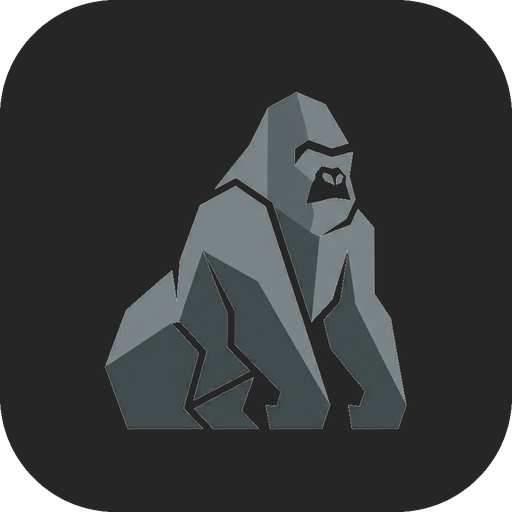
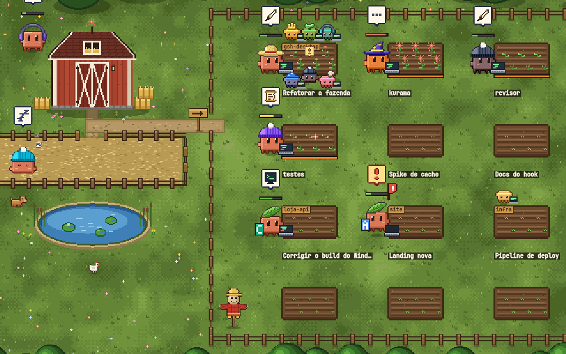
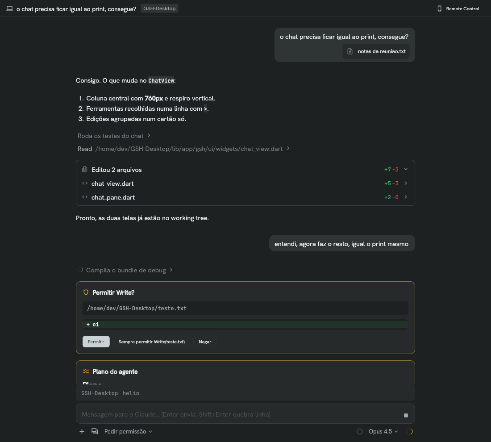
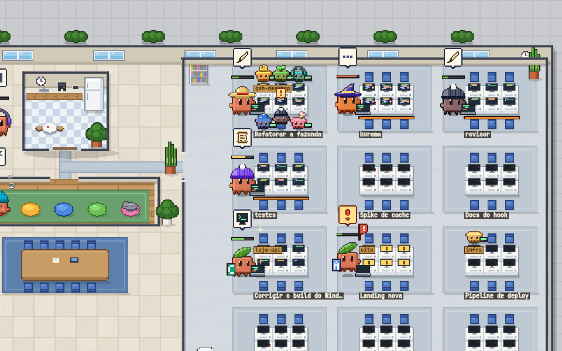
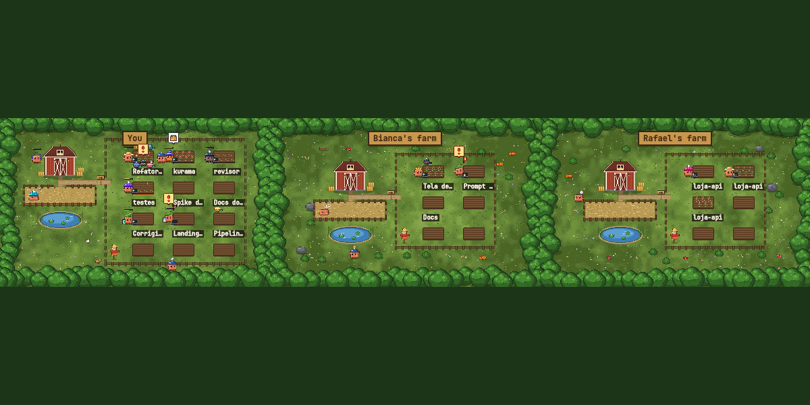
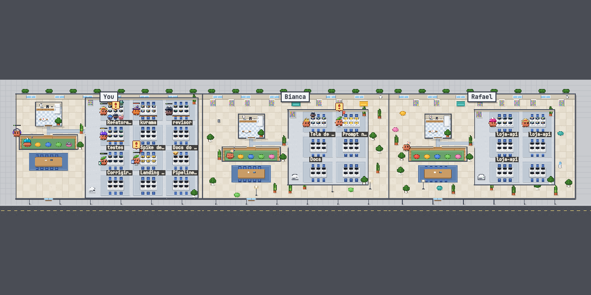
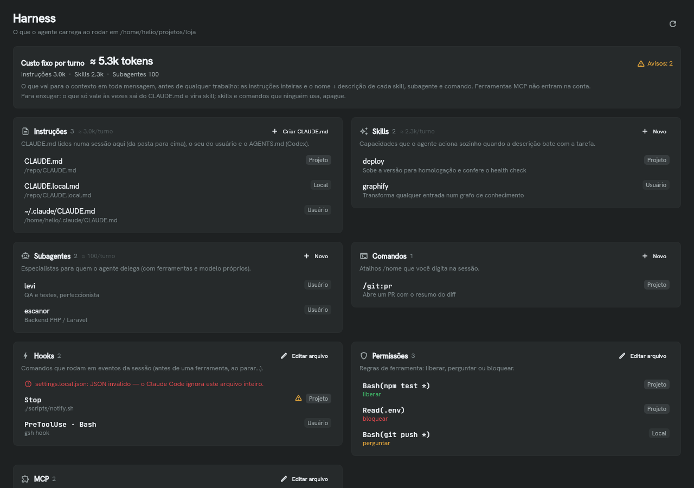
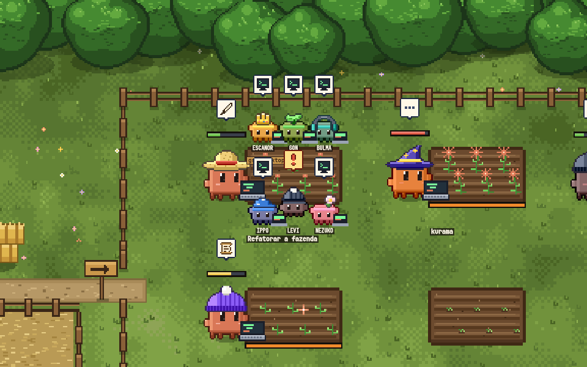
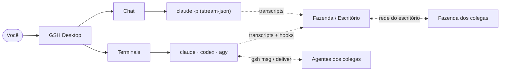

<div align="center">



# 🦍 GSH Desktop — o cockpit da Gorila para agentes de código

### Seus agentes trabalhando à vista. Terminais, chat estilo Claude Desktop e uma **fazenda pixel art** que mostra quem está trabalhando, quem precisa de você e quanto cada um gastou.

_Usa o `claude` (e o `codex`, o `agy`) da sua máquina, com o seu login. **Nenhuma chave de API passa pelo app.**_

**Terminais • Chat nativo • Fazenda / Escritório • Fazenda do time • Agentes conversando • Harness • Hosts protegidos • Windows · macOS · Linux**

<br/>

[](https://github.com/Mystic0112/GSH-Desktop/releases)
[](#-baixar-e-instalar)
[](https://code.claude.com)
[](https://flutter.dev)
[](cli/)
[](LICENSE)

[⚡ Baixar](#-baixar-e-instalar) • [💡 Recursos](#-recursos) • [🔄 Como funciona](#-como-funciona) • [🎮 Atalhos](#-atalhos) • [🧑‍💻 Desenvolver](#-desenvolver) • [🙏 Créditos](#-créditos)

</div>

---

## 🖼️ A fazenda

<div align="center">
  
  <br/>
  <sub>Cada canteiro é um projeto, cada gorila é um agente. Verde trabalhando, <b>amarelo precisa de você</b>, azul parado. A barrinha em cima é o contexto da conversa.</sub>
</div>

---

## 📸 Telas

<details>
<summary><b>Clique para ver mais telas</b></summary>

<br/>

| Tela | |
| --- | --- |
| **Chat** — estilo Claude Desktop: permissões em cartão, diffs, plano, modelo e uso |  |
| **Escritório** — o mesmo, em versão escritório (monitor aceso = trabalhando) |  |
| **Fazenda do time** — a fazenda dos colegas ao lado da sua, na rede do escritório |  |
| **Escritório do time** — um prédio só, uma sala por pessoa |  |
| **Harness** — tudo que o agente carrega no projeto, com avisos e custo por turno |  |
| **Contexto** — quanto da conversa cada agente já usou |  |

</details>

---

## 🤔 Por que o GSH?

Quem trabalha com vários agentes ao mesmo tempo perde o fio: qual terminal está esperando permissão, qual travou, qual já terminou, quanto tudo isso está custando. O GSH junta tudo num lugar só:

| Sem o GSH | Com o GSH |
| --- | --- |
| Caçar entre abas qual agente parou pedindo permissão | Fila **"precisa de você"** no topo e o gorila **amarelo** na fazenda |
| Não saber quanto cada sessão gastou | Tokens gastos por agente no hover, total do dia no HUD, **uso do plano** no chat |
| Agentes de colegas mexendo no mesmo sistema sem conversar | **Agentes do time trocando mensagens e arquivos** pela rede do escritório, com aprovação |
| Medo de um agente rodar algo em produção | **Hosts protegidos**: comando que cite `prod`, `homolog`… é bloqueado em qualquer sessão |
| Skills, hooks e MCP espalhados em mil arquivos | Aba **Harness** com tudo do projeto, avisos e quanto pesa em cada mensagem |

---

## ⚡ Baixar e instalar

> Pré-requisito: o [**Claude Code**](https://code.claude.com) instalado e logado (`claude` no terminal). Codex (`codex`) e Antigravity (`agy`) são opcionais.

Baixe na página de **[Releases](https://github.com/Mystic0112/GSH-Desktop/releases)**:

| Sistema | Arquivo |
| --- | --- |
| 🪟 **Windows** | `GSH-Desktop-windows-x64-setup.exe` (ou o `…-portable.zip`) |
| 🍎 **macOS** (Apple Silicon e Intel) | `GSH-Desktop-macos.dmg` |
| 🐧 **Linux** x64 | `GSH-Desktop-linux-x64.tar.gz` |

<details>
<summary><b>🪟 Windows</b></summary>

1. Rode o `GSH-Desktop-windows-x64-setup.exe` — instala só para o seu usuário, sem pedir admin.
2. O SmartScreen avisa (ainda não é assinado): **Mais informações → Executar assim mesmo**.
3. Na primeira vez, permita o GSH em **rede privada** no Firewall (fazenda do time e conversa entre agentes usam a rede local).

</details>

<details>
<summary><b>🍎 macOS</b></summary>

1. Abra o `.dmg` e arraste o **GSH.app** para **Aplicativos**.
2. Primeira vez: botão direito no app → **Abrir** → **Abrir** (no macOS 15+: *Ajustes do Sistema → Privacidade e Segurança → Abrir Mesmo Assim*). Ou, uma vez no terminal:
   ```bash
   xattr -dr com.apple.quarantine "/Applications/GSH.app"
   ```
3. Aceite as permissões que ele pedir (rede local, pastas, notificações).

</details>

<details>
<summary><b>🐧 Linux</b></summary>

```bash
tar -xzf GSH-Desktop-linux-x64.tar.gz
cd GSH-Desktop && ./install.sh   # menu de apps + ícone do gorila (só seu usuário)
./gsh
```

</details>

---

## 💡 Recursos

### 🖥️ Terminais e agentes
- Panes e abas de terminal (Ghostty), divididos à vontade; workspaces por pasta, git, worktrees, árvore de arquivos, editor, bancos (SQLite, Postgres, MySQL, MSSQL, Mongo, Redis), tasks e navegador embutido.
- **Status de turno** de cada agente nas abas e no rail, via hooks: trabalhando, esperando você, parado.
- Agentes falam entre si: `gsh msg --to <aba> "…"`, `gsh peers`, e o servidor MCP `gsh` para apps desktop.

### 💬 Chat nativo (estilo Claude Desktop)
- Conversa com o Claude Code: permissões em cartão (**Sempre permitir** grava a regra), diffs agrupados, plano, perguntas com opções, raciocínio.
- **Anexos** e print colado com Ctrl+V; **troca de modelo** com a lista da sua conta; **uso** do contexto e dos limites do plano (5 h, semana).
- Menu do **`/`** com seus agentes, skills e comandos; **Retomar conversa** de qualquer sessão recente do Claude Code (inclusive do Claude Desktop).
- **Remote Control**: continue a conversa no celular ou em claude.ai/code. Modo experimental em que o próprio chat já nasce no Remote Control.
- Conversa entre sessões do Claude Code (aceitar por padrão, configurável).

### 🌾 Fazenda / 🏢 Escritório
- Cada **loop de agente** da máquina vira um personagem — Claude Code, Codex e Antigravity, inclusive sessões abertas fora do GSH.
- Subagentes em volta do agente principal, balão com a ferramenta atual, **barra de contexto**, tokens gastos no hover, fila **"precisa de você"**.
- Clique no agente abre o terminal dele (ou retoma a sessão parada).
- Dois cenários (troque no canto da cena), canteiros arrastáveis, caminhos de verdade, bichinhos 🐕 🐔 🐈.

### 👥 Time
- **Fazenda do time**: na rede do escritório, as fazendas dos colegas aparecem ao lado da sua. Sem servidor (multicast), opt-in, títulos escondidos por padrão.
- **Agentes conversando**: `gsh msg --to "Fulano/aba"` e `gsh deliver --to "Fulano/aba" relatorio.pdf`. A mensagem **bate na porta** do agente do colega e chega como informação de colega, não como ordem. Lista de quem pode bater, "perguntar antes de abrir", senha do time (HMAC). Um **carteiro** pixel art leva a entrega de um lote ao outro.

### 🧰 Harness
- Aba por projeto com **instruções** (CLAUDE.md, AGENTS.md), **skills**, **subagentes**, **comandos**, **hooks**, **permissões** e **MCP**, cada um com o escopo (projeto, local, usuário).
- Cria skill, subagente e comando por modelo; **linter** (sem descrição, script que não existe, JSON quebrado) e **custo fixo por turno**.

### 🛡️ Segurança
- **Hosts protegidos**: nenhum agente roda comando que cite um host da lista, em qualquer sessão e modo de permissão.
- Mensagens entre agentes de colegas só entram em abas com agente rodando, assinadas e com aprovação opcional.

---

## 🔄 Como funciona



- O motor é sempre o **CLI da sua máquina** com o seu login. O GSH não fala com a API da Anthropic.
- A fazenda lê os **transcripts** que o próprio Claude Code / Codex gravam, e os **hooks** do `gsh` contam quem está esperando você.
- A CLI interna **`gsh`** (Rust) cuida de hooks, mensagens entre agentes, MCP e comandos de aba.

---

## 🎮 Atalhos

| Atalho | Ação |
| --- | --- |
| `Ctrl+T` | Novo terminal |
| `Ctrl+Shift+L` | Novo chat |
| `Ctrl+Shift+J` | Chat numa pane à direita |
| `Ctrl+D` / `Ctrl+Shift+D` | Dividir à direita / abaixo |
| `Ctrl+P` | Ir para arquivo |
| `Ctrl+Shift+F` | Buscar nos arquivos |
| `Ctrl+1…9` | Ir para a aba |
| ``Ctrl+` `` | Próximo workspace |

No macOS, `⌘` no lugar de `Ctrl`. Lista completa em *Configurações → Atalhos*.

---

## 🧑‍💻 Desenvolver

**Pré-requisitos:** Flutter **3.44.1**, Rust (`cargo`), Zig **0.16.0** (compila o libghostty) e o `claude` logado.

```bash
flutter pub get
flutter run -d linux        # ou macos / windows
```

Antes de commitar:

```bash
flutter analyze && flutter test test/data && (cd cli && cargo test)
```

| Pasta | O que é |
| --- | --- |
| `lib/app/gsh/` | O shell: workspaces, panes, terminais, chat, fazenda, harness, time |
| `lib/app/settings/` | Configurações (lados **GSH** e **Claude**) |
| `lib/app/core/` | O que é compartilhado (tema, settings, leitores do Claude) |
| `cli/` | CLI `gsh` em Rust: hooks, mensagens, MCP |
| `packages/`, `plugins/` | Motor compartilhado com o `gsh-server`, PTY nativo |
| `.github/workflows/` | Builds de Windows, macOS, Linux e releases |

Regras de arquitetura em [`CLAUDE.md`](CLAUDE.md) e [`lib/app/CLAUDE.md`](lib/app/CLAUDE.md); design em [`docs/design-system.md`](docs/design-system.md).

### 🚀 Soltar uma versão

```bash
git tag gsh-AAAA.MM.DD && git push origin gsh-AAAA.MM.DD
```

Em ~30 min o GitHub compila Windows, macOS e Linux e publica a **pré-release** com as notas. Detalhes em [`packaging/README.md`](packaging/README.md).

### 🌿 Fluxo

`master` estável · `helio` harness/chat · `yan` fazenda/visibilidade · PR para o `master`. Backlog na lista **GSH Desktop** do ClickUp.

---

## 🙏 Créditos

- Fork do **[Cockpit](https://github.com/jacobaraujo7/remote_pi)** (Remote Pi), de Jacob Moura — MIT.
- Mundo pixel art da fazenda portado do **[clodfarm](https://github.com/matank001/clodfarm)** — MIT ([licença](third_party/clodfarm/LICENSE)).
- Escritório inspirado no **[habblaud](https://github.com/marmottajr/habblaud)**; ideias do **[pixel-agents](https://github.com/pixel-agents-hq/pixel-agents)** e do **[Harness²](https://github.com/google-research/harness2)** — arte e código do GSH são próprios.

## 📄 Licença

MIT — veja [`LICENSE`](LICENSE).

<div align="center">
<br/>
<sub>Feito pela <a href="https://gorilash.com.br">Gorila Software House</a> 🦍</sub>
</div>
